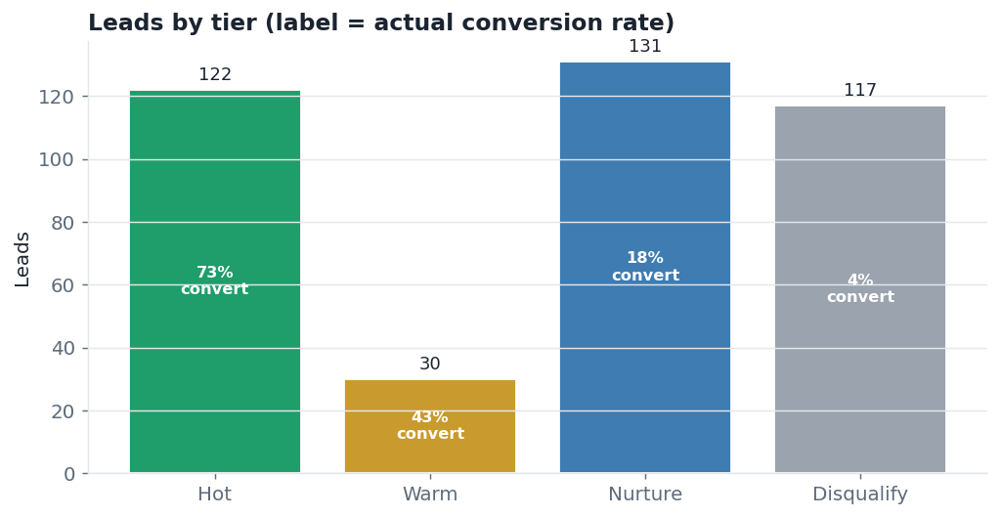
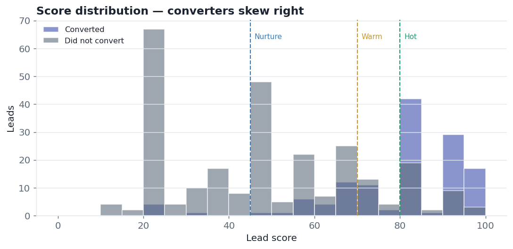
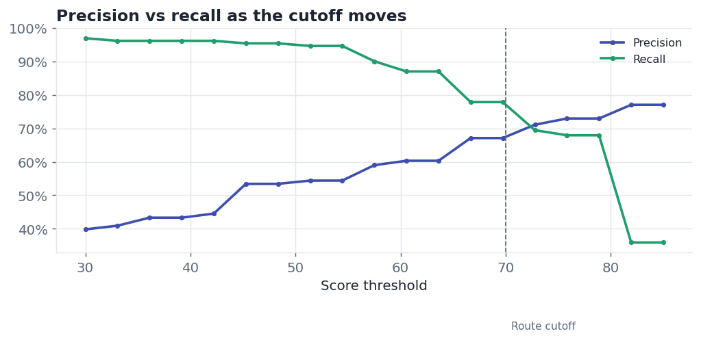
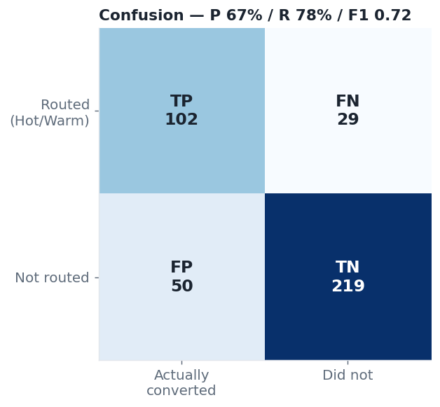

# LeadSignal AI — lead qualification agent

Scores inbound B2B leads against an ideal customer profile, explains each call,
drafts the first-touch email, and — because an LLM shouldn't be trusted blindly —
runs every score through deterministic guardrails and an evaluation harness.




## The problem

Reps waste time on leads that were never going to buy, while good ones go cold.
LeadSignal turns a raw inbound list into a **ranked call sheet**: each lead gets a
0–100 score, a tier, the reasons behind it, and a ready-to-send email — so a rep
opens the list and starts at the top.

## Results (400-lead evaluation)

Scores are checked against a held-out "converted" label:

| Metric | Value |
|---|---|
| Precision (routed leads that convert) | **67%** |
| Recall (converters we catch) | **78%** |
| F1 | **0.72** |
| Top-decile conversion rate | **85%** vs a **33%** base — a **2.6× lift** |

The tiers stratify cleanly: **Hot leads convert at 73%, Warm 43%, Nurture 18%,
Disqualify 4%.** The point of the score is that ordering.

## How it works

```
raw lead ─▶ enrich ─▶ score (Claude or offline) ─▶ guardrails ─▶ LeadScore
             │            │                            │
      ICP match +   structured JSON,            hard disqualifiers
      intent signals  validated by Pydantic     override the model
```

- **Structured output, not a chatbot.** Every score is a Pydantic `LeadScore` — a malformed model response fails loudly instead of leaking downstream. See [models.py](src/models.py).
- **Guardrails over the model.** Blocked industry/region or above the size cap forces `Disqualify`, whatever the LLM said ([rules.py](src/rules.py)) — so a confident-but-wrong model can't route a lead it shouldn't.
- **It's measured.** [evaluate.py](src/evaluate.py) reports precision/recall/F1 and a confusion matrix against labels, plus a threshold sweep so you can pick the precision/recall trade-off.
- **Explainable + actionable.** Each lead comes with reasons, risks, a recommended action, and a drafted email.

## A scored lead

```json
{
  "lead_id": "L0051", "score": 100, "tier": "Hot",
  "fit_reasons": ["Industry SaaS matches ICP", "980 employees in target range",
                  "United States is a target region",
                  "Intent signals: raised, series, new office"],
  "recommended_action": "Route to AE for same-day outreach",
  "draft_email": "Hi there — congrats on the recent raise. Teams like yours in
                  SaaS use us to cut manual reporting time. Worth 15 minutes?"
}
```

## Charts

| Score distribution | Precision vs recall |
|---|---|
|  |  |

| Confusion matrix | |
|---|---|
|  | |

## Quickstart

```bash
python3 -m venv .venv && source .venv/bin/activate
pip install -r requirements.txt

python src/run.py          # generate leads, score, evaluate, write charts + call sheet
python tests/test_agent.py # tests (no network)
streamlit run app.py       # interactive call sheet
```

### Scoring with Claude vs offline

Out of the box it runs a **transparent, rule-based offline scorer** so you can
try it with no API key — and the numbers above are from that offline scorer. Set
an Anthropic key to score with the model instead:

```bash
export ANTHROPIC_API_KEY=sk-ant-...
python src/run.py
```

The prompt the model uses is in [prompts/score_lead.md](prompts/score_lead.md);
the ICP it scores against is [config/icp.json](config/icp.json).

## Repo structure

```
leadsignal-ai/
├─ app.py                 Streamlit call sheet
├─ src/
│  ├─ generate_leads.py   synthetic leads + ground-truth labels
│  ├─ enrich.py           ICP match + intent-signal detection
│  ├─ llm.py              Claude scorer + offline fallback
│  ├─ models.py           Pydantic LeadScore schema
│  ├─ rules.py            deterministic guardrails
│  ├─ agent.py            enrich → score → guardrails
│  ├─ evaluate.py         precision / recall / confusion
│  ├─ viz.py              charts
│  └─ run.py              end-to-end
├─ prompts/score_lead.md  the scoring prompt
├─ config/icp.json        ideal customer profile
├─ examples/              call sheet, sample lead, metrics
├─ tests/                 pipeline tests
└─ assets/                charts
```

## Notes

- The lead list is **synthetic**, generated with a known "converted" label so the
  scorer can actually be graded. Swap in a real CRM export (same columns) to run
  it for real.
- Offline-scorer metrics are a floor; the Claude scorer reads the free-text
  message more flexibly. Both pass through the same guardrails and evaluation.
- Not connected to any live CRM — it reads and writes CSVs.
